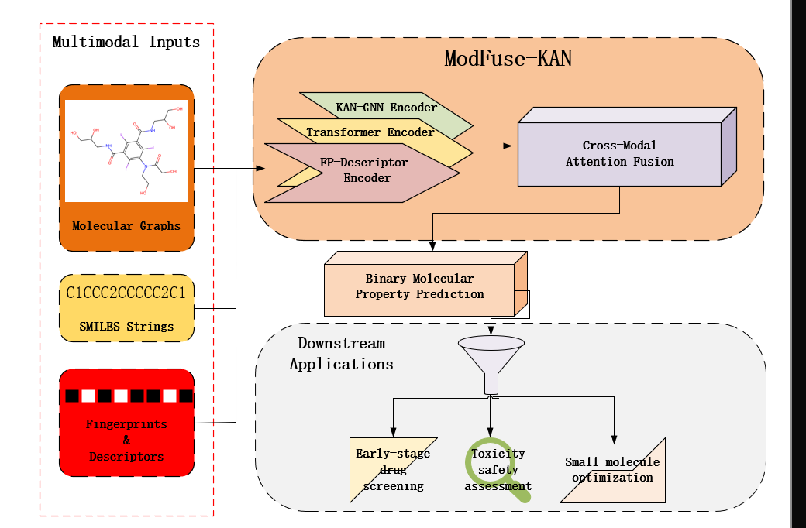

# About US
ModFuse-KAN is a multimodal molecular property prediction model built upon KAN-enhanced graph neural network, Transformer encoder and physicochemical feature module. The model fuses graph topological information, SMILES sequence semantics and handcrafted molecular descriptors to accurately predict molecular bioactivity. 
The architecture of ModFuse-KAN is as follows:
<p align="center">

<br>
Figure 1: Overview architecture of ModFuse-KAN.
</p>

# Project Structure
Please verify the integrity of the project structure and the correctness of folder naming before running the project.

```
ModFuse-KAN/
├── config/
│   └── c_path.yaml          # Global path, dataset and model hyperparameter config
├── data/
│   ├── bace.csv
│   └── bbbp.csv              # Molecular benchmark datasets (BACE/BBBP, Tox21/MUV will be added later)
├── model/
│   └── kan_gnn_multimodal.py # Core multimodal KAN-GNN model of ModFuse-KAN
├── utils/
│   ├── graph_path.py          # Tools for molecular graph construction and path processing
│   └── multimodal_feats.py   # Multimodal molecular feature extraction tools
└── go4.py                      # Main entry script for model training
```

# Installation and Requirements
It is recommended to use the same library versions as specified. Using a conda virtual environment is also recommended to avoid affecting other parts of the system. Please follow the steps below.

Key libraries and versions:
├── torch                2.0.1+cu117
├── dgl-cu117            2.1
├── numpy                1.23.1
├── networkx             2.8
├── rdkit-pypi           2022.3.4
├── scikit-learn         1.1.1
├── pandas               1.4.2
├── logzero              1.7.0
├── PyYAML               6.0
├── jarvis-tools         2023.12.12
└── pykan

Step 1: Download Code and Data
Use the following command to download this project or download the zip file from the "Code" section at the top right:
git init
git clone https://github.com/sys-yz/ModFuse-KAN.git

Step 2: Run the Model
Run the main script in the virtual environment:
python go4.py --dataset bace

# Citation
If you use our code or model in your research, please cite this work and star this repository to show your support. Thank you!
Paper Link: This manuscript is currently under submission.
